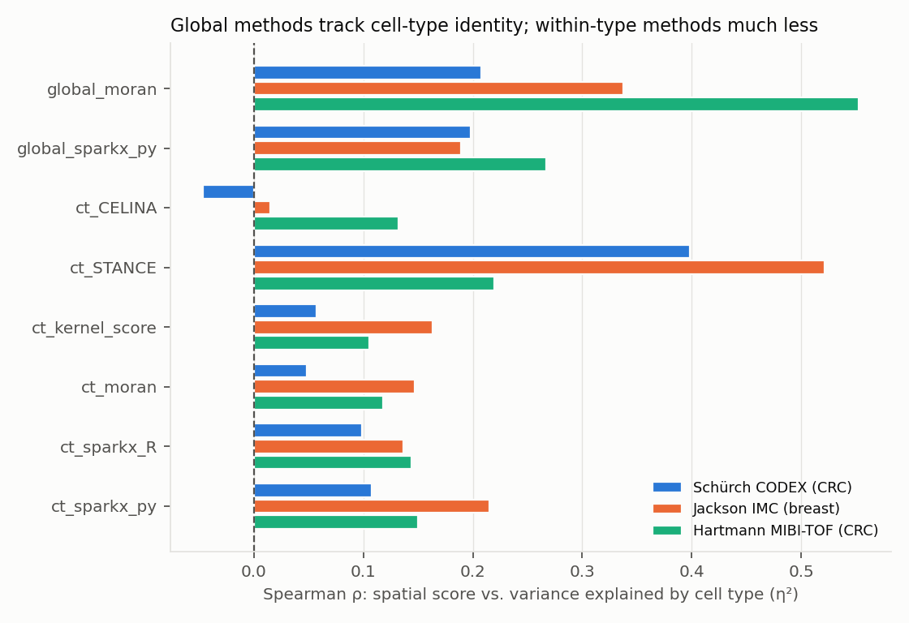
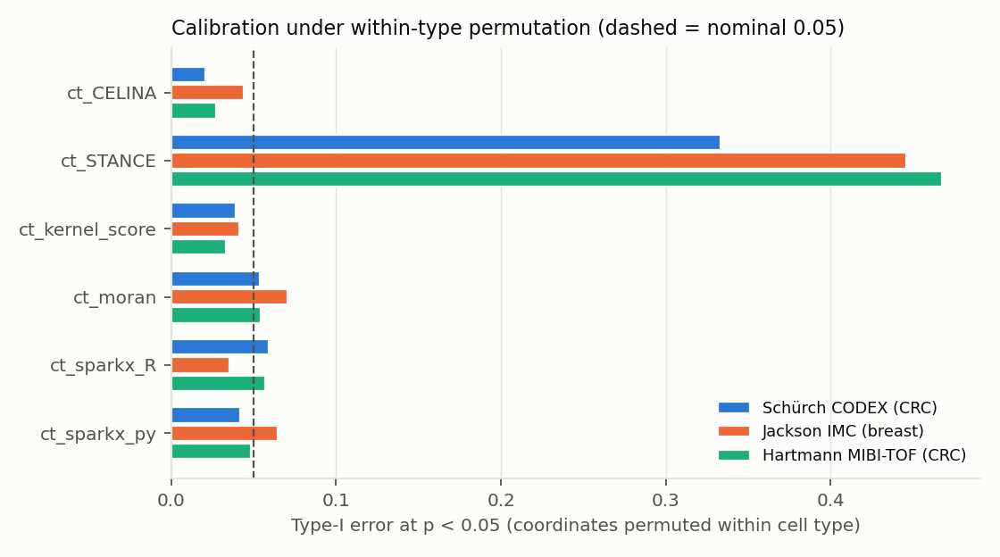
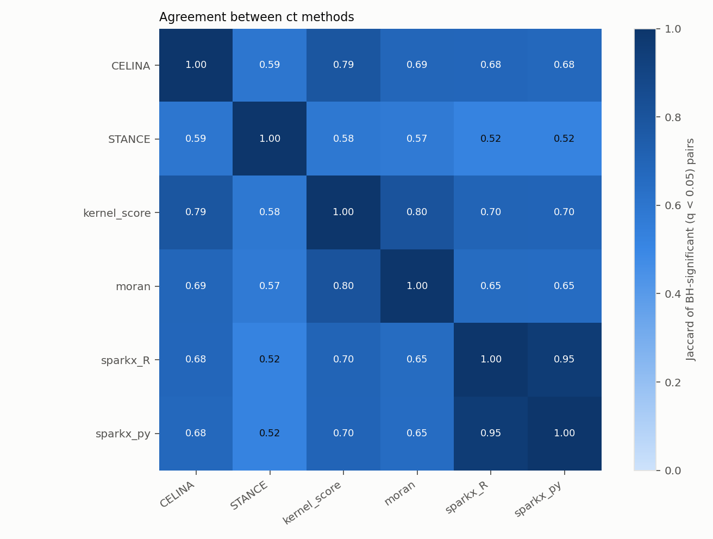
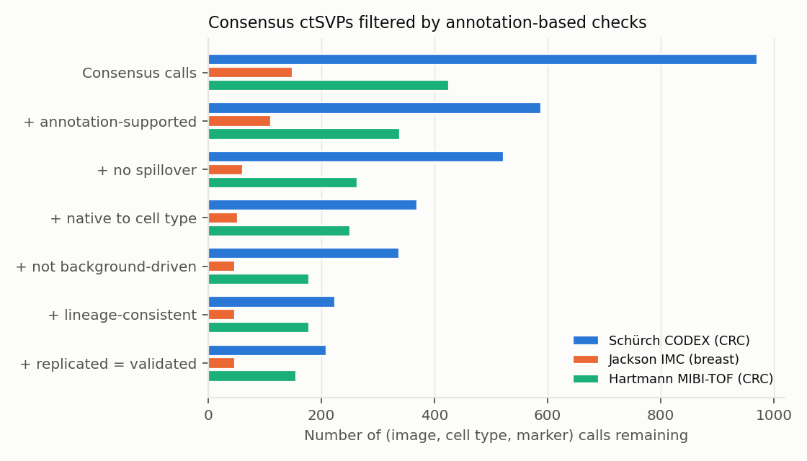

# Simple pipeline: results summary

Auto-generated by `src/report.py`. Zero-shot run: fixed defaults, no tuning; validation uses the original dataset annotations, which detection never sees beyond the cell-type labels.

**ct methods aggregated:** ct_CELINA, ct_STANCE, ct_kernel_score, ct_moran, ct_sparkx_R, ct_sparkx_py  
**Tested (image, cell type, marker) pairs:** 3358  
**Consensus calls** (ACAT q < 0.05 and a strict majority of methods at BH q < 0.05): 1546  
**Validated candidates:** 412

## 1. Composition confounding (benchmark claim reproduced)

Mean Spearman ρ between each marker's spatial score and the share of its variance explained by annotated cell type (η²). Global SVG methods mostly rediscover cell-type identity; within-type testing removes most of that.

| method | Hartmann MIBI-TOF (CRC) | Jackson IMC (breast) | Schürch CODEX (CRC) |
|---|---|---|---|
| global_moran | 0.553 | 0.337 | 0.208 |
| global_sparkx_py | 0.267 | 0.189 | 0.198 |
| ct_CELINA | 0.132 | 0.0149 | -0.0465 |
| ct_STANCE | 0.22 | 0.521 | 0.399 |
| ct_kernel_score | 0.106 | 0.163 | 0.057 |
| ct_moran | 0.118 | 0.147 | 0.0481 |
| ct_sparkx_R | 0.144 | 0.137 | 0.0988 |
| ct_sparkx_py | 0.15 | 0.215 | 0.108 |

## 2. Calibration (within-type permutation null)

| dataset | method | typeI_005 | ks | n_bh_calls |
|---|---|---|---|---|
| hartmann_mibi | ct_CELINA | 0.0271 | 0.11 | 0 |
| hartmann_mibi | ct_STANCE | 0.468 | 0.436 | 269 |
| hartmann_mibi | ct_kernel_score | 0.0331 | 0.0639 | 0 |
| hartmann_mibi | ct_moran | 0.0541 | 0.108 | 0 |
| hartmann_mibi | ct_sparkx_R | 0.0571 | 0.0504 | 0 |
| hartmann_mibi | ct_sparkx_py | 0.0481 | 0.0715 | 0 |
| jackson_imc | ct_CELINA | 0.044 | 0.194 | 0 |
| jackson_imc | ct_STANCE | 0.446 | 0.426 | 125 |
| jackson_imc | ct_kernel_score | 0.0411 | 0.0437 | 0 |
| jackson_imc | ct_moran | 0.0704 | 0.0501 | 1 |
| jackson_imc | ct_sparkx_R | 0.0352 | 0.0578 | 0 |
| jackson_imc | ct_sparkx_py | 0.0645 | 0.0672 | 0 |
| schurch_codex | ct_CELINA | 0.0208 | 0.22 | 0 |
| schurch_codex | ct_STANCE | 0.333 | 0.284 | 474 |
| schurch_codex | ct_kernel_score | 0.0391 | 0.0601 | 0 |
| schurch_codex | ct_moran | 0.0536 | 0.0475 | 0 |
| schurch_codex | ct_sparkx_R | 0.0591 | 0.0486 | 0 |
| schurch_codex | ct_sparkx_py | 0.0421 | 0.0246 | 0 |

## 3. What the methods have in common

Pairwise Jaccard of significant sets / Spearman of −log10 p:

| method_a | method_b | n_pairs | jaccard | spearman |
|---|---|---|---|---|
| ct_CELINA | ct_STANCE | 2798 | 0.593 | 0.683 |
| ct_CELINA | ct_kernel_score | 3358 | 0.788 | 0.877 |
| ct_CELINA | ct_moran | 3358 | 0.688 | 0.826 |
| ct_CELINA | ct_sparkx_R | 3358 | 0.684 | 0.763 |
| ct_CELINA | ct_sparkx_py | 3358 | 0.68 | 0.759 |
| ct_STANCE | ct_kernel_score | 2798 | 0.582 | 0.55 |
| ct_STANCE | ct_moran | 2798 | 0.574 | 0.533 |
| ct_STANCE | ct_sparkx_R | 2798 | 0.518 | 0.483 |
| ct_STANCE | ct_sparkx_py | 2798 | 0.516 | 0.483 |
| ct_kernel_score | ct_moran | 3358 | 0.803 | 0.913 |
| ct_kernel_score | ct_sparkx_R | 3358 | 0.7 | 0.857 |
| ct_kernel_score | ct_sparkx_py | 3358 | 0.699 | 0.854 |
| ct_moran | ct_sparkx_R | 3358 | 0.652 | 0.804 |
| ct_moran | ct_sparkx_py | 3358 | 0.65 | 0.801 |
| ct_sparkx_R | ct_sparkx_py | 3358 | 0.954 | 0.971 |

Python SPARK-X port vs official R SPARK-X (same pairs; R subsamples cells independently):

| dataset | n | spearman | agree_at_005 |
|---|---|---|---|
| hartmann_mibi | 665 | 0.989 | 0.973 |
| jackson_imc | 341 | 0.958 | 0.968 |
| schurch_codex | 2.35e+03 | 0.965 | 0.96 |

Consensus themes shared by ≥ 2 datasets **before** validation (coarse cell type × marker), top 15:

| coarse_type | marker | n_datasets | n_images | datasets |
|---|---|---|---|---|
| tumor/epithelial | KI67 | 3 | 8 | hartmann_mibi;jackson_imc;schurch_codex |
| tumor/epithelial | PANCK | 3 | 8 | hartmann_mibi;jackson_imc;schurch_codex |
| CD4 T | CD45 | 3 | 7 | hartmann_mibi;jackson_imc;schurch_codex |
| CD4 T | SMA | 3 | 7 | hartmann_mibi;jackson_imc;schurch_codex |
| endothelial | VIMENTIN | 3 | 7 | hartmann_mibi;jackson_imc;schurch_codex |
| myeloid | CD68 | 3 | 7 | hartmann_mibi;jackson_imc;schurch_codex |
| stromal | SMA | 3 | 7 | hartmann_mibi;jackson_imc;schurch_codex |
| stromal | VIMENTIN | 3 | 7 | hartmann_mibi;jackson_imc;schurch_codex |
| tumor/epithelial | CD45 | 3 | 7 | hartmann_mibi;jackson_imc;schurch_codex |
| tumor/epithelial | CD68 | 3 | 7 | hartmann_mibi;jackson_imc;schurch_codex |
| tumor/epithelial | SMA | 3 | 7 | hartmann_mibi;jackson_imc;schurch_codex |
| CD4 T | VIMENTIN | 3 | 6 | hartmann_mibi;jackson_imc;schurch_codex |
| myeloid | CD45 | 3 | 6 | hartmann_mibi;jackson_imc;schurch_codex |
| myeloid | VIMENTIN | 3 | 6 | hartmann_mibi;jackson_imc;schurch_codex |
| tumor/epithelial | VIMENTIN | 3 | 6 | hartmann_mibi;jackson_imc;schurch_codex |

The same, **after** validation:

| coarse_type | marker | datasets | n_datasets | images |
|---|---|---|---|---|
| stromal | SMA | hartmann_mibi;jackson_imc;schurch_codex | 3 | 5 |
| tumor/epithelial | KI67 | hartmann_mibi;jackson_imc;schurch_codex | 3 | 5 |
| tumor/epithelial | PANCK | hartmann_mibi;jackson_imc;schurch_codex | 3 | 5 |
| tumor/epithelial | EGFR | jackson_imc;schurch_codex | 2 | 6 |
| tumor/epithelial | NAKATPASE | hartmann_mibi;schurch_codex | 2 | 6 |
| CD4 T | CD45 | hartmann_mibi;schurch_codex | 2 | 5 |
| endothelial | VIMENTIN | hartmann_mibi;schurch_codex | 2 | 5 |
| myeloid | CD11C | hartmann_mibi;schurch_codex | 2 | 5 |
| tumor/epithelial | PD1 | hartmann_mibi;schurch_codex | 2 | 5 |
| myeloid | CD68 | jackson_imc;schurch_codex | 2 | 4 |
| stromal | VIMENTIN | hartmann_mibi;schurch_codex | 2 | 4 |
| tumor/epithelial | ECAD | hartmann_mibi;jackson_imc | 2 | 4 |
| tumor/epithelial | P53 | jackson_imc;schurch_codex | 2 | 3 |
| CD4 T | P53 | jackson_imc;schurch_codex | 2 | 2 |

## 4. Validation against original annotations

Enrichment of annotation support (authors' cellular-neighbourhood labels; annotated neighbour composition) among consensus vs. non-consensus pairs:

| dataset | annotation | n_pairs | support_rate_consensus | support_rate_non_consensus | odds_ratio | fisher_p |
|---|---|---|---|---|---|---|
| hartmann_mibi | composition | 665 | 0.796 | 0.192 | 16.3 | 1.46e-53 |
| jackson_imc | composition | 341 | 0.745 | 0.318 | 6.27 | 3.37e-15 |
| schurch_codex | niche_label | 1904 | 0.293 | 0.051 | 7.72 | 2.08e-48 |
| schurch_codex | composition | 2352 | 0.562 | 0.138 | 8 | 8.66e-107 |

Replication across images (consensus in ≥ 2 images), observed vs. permuted null:

| dataset | data | pairs_seen_in_2plus_images | called_in_any | replicated_2plus | replication_rate |
|---|---|---|---|---|---|
| hartmann_mibi | observed | 245 | 203 | 131 | 0.645 |
| schurch_codex | observed | 560 | 413 | 271 | 0.656 |
| hartmann_mibi | permuted null | 245 | 0 | 0 | nan |
| schurch_codex | permuted null | 560 | 0 | 0 | nan |

Validation funnel:

| step | Hartmann MIBI-TOF (CRC) | Jackson IMC (breast) | Schürch CODEX (CRC) |
|---|---|---|---|
| Consensus calls | 426 | 149 | 971 |
| + annotation-supported | 339 | 111 | 589 |
| + no spillover | 264 | 62 | 523 |
| + native to cell type | 251 | 52 | 369 |
| + not background-driven | 179 | 47 | 338 |
| + lineage-consistent | 179 | 47 | 224 |
| + replicated = validated | 156 | 47 | 209 |

Most frequent calls removed as likely **spillover** (marker leaking from the named neighbour type):

| dataset | cell_type | feature | spillover_source | images |
|---|---|---|---|---|
| hartmann_mibi | Imm_other | SMA | Fibroblast | 3 |
| hartmann_mibi | Tcell_CD4 | SMA | Fibroblast | 3 |
| hartmann_mibi | Tcell_CD4 | CK | Epithelial | 3 |
| hartmann_mibi | Imm_other | GLUT1 | Epithelial | 2 |
| schurch_codex | CD4+ T cells CD45RO+ | CD38 | plasma cells | 2 |
| hartmann_mibi | Imm_other | CD3 | Tcell_CD8 | 2 |
| hartmann_mibi | Imm_other | ASCT2 | Epithelial | 2 |
| schurch_codex | stroma | aSMA | smooth muscle | 2 |
| hartmann_mibi | Fibroblast | CS | Myeloid_CD68 | 2 |
| schurch_codex | CD4+ T cells CD45RO+ | CD20 | B cells | 2 |
| schurch_codex | CD4+ T cells CD45RO+ | aSMA | smooth muscle | 2 |
| hartmann_mibi | Fibroblast | CD45 | Tcell_CD8 | 2 |

## 5. Validated candidate ctSVPs (top 12 per dataset)

| dataset | cell_type | feature | images | best_acat_q |
|---|---|---|---|---|
| hartmann_mibi | Epithelial | ATP5A | 3 | 2.04e-14 |
| hartmann_mibi | Epithelial | CD36 | 3 | 2.04e-14 |
| hartmann_mibi | Epithelial | Ecad | 3 | 2.04e-14 |
| hartmann_mibi | Epithelial | GLUT1 | 3 | 2.04e-14 |
| hartmann_mibi | Epithelial | LDHA | 3 | 2.04e-14 |
| hartmann_mibi | Epithelial | NRF2p | 3 | 2.04e-14 |
| hartmann_mibi | Epithelial | VDAC1 | 3 | 2.04e-14 |
| hartmann_mibi | Tcell_CD4 | CD98 | 3 | 2.04e-14 |
| hartmann_mibi | Tcell_CD4 | S6p | 3 | 2.16e-14 |
| hartmann_mibi | Tcell_CD8 | CD98 | 3 | 2.16e-14 |
| hartmann_mibi | Epithelial | XBP1 | 3 | 2.35e-14 |
| hartmann_mibi | Imm_other | HK1 | 3 | 2.35e-14 |
| jackson_imc | CK+ HR+ tumor cell | ECadhe_Er167 | 1 | 2.52e-14 |
| jackson_imc | T cells | CD44_Gd160 | 1 | 2.52e-14 |
| jackson_imc | T cells | Fibrone_Nd142 | 1 | 2.52e-14 |
| jackson_imc | T cells | Slug_Gd155 | 1 | 2.52e-14 |
| jackson_imc | apoptotic tumor cell | CD44_Gd160 | 1 | 2.52e-14 |
| jackson_imc | apoptotic tumor cell | Carboni_Er166 | 1 | 2.52e-14 |
| jackson_imc | apoptotic tumor cell | Cytoker_Nd144 | 1 | 2.52e-14 |
| jackson_imc | apoptotic tumor cell | ECadhe_Er167 | 1 | 2.52e-14 |
| jackson_imc | apoptotic tumor cell | EGFR_Tm169 | 1 | 2.52e-14 |
| jackson_imc | apoptotic tumor cell | Estroge_Gd156 | 1 | 2.52e-14 |
| jackson_imc | apoptotic tumor cell | Progest_Gd158 | 1 | 2.52e-14 |
| jackson_imc | apoptotic tumor cell | Slug_Gd155 | 1 | 2.52e-14 |
| schurch_codex | tumor cells | CD194 | 5 | 3.79e-14 |
| schurch_codex | tumor cells | EGFR | 5 | 3.79e-14 |
| schurch_codex | tumor cells | MMP12 | 5 | 3.79e-14 |
| schurch_codex | tumor cells | Na-K-ATPase | 5 | 3.79e-14 |
| schurch_codex | CD68+CD163+ macrophages | CD11c | 4 | 3.79e-14 |
| schurch_codex | CD68+CD163+ macrophages | CD71 | 4 | 3.79e-14 |
| schurch_codex | stroma | Collagen IV | 4 | 3.79e-14 |
| schurch_codex | tumor cells | CD71 | 4 | 3.79e-14 |
| schurch_codex | tumor cells | LAG-3 | 4 | 3.79e-14 |
| schurch_codex | vasculature | Vimentin | 4 | 3.79e-14 |
| schurch_codex | CD4+ T cells CD45RO+ | CD3 | 3 | 3.79e-14 |
| schurch_codex | CD4+ T cells CD45RO+ | CD45 | 3 | 3.79e-14 |

Full lists: `validation/consensus_with_validation.csv` (every flag per call), `aggregate/pairs_observed.csv` (every method's p/q per pair).
