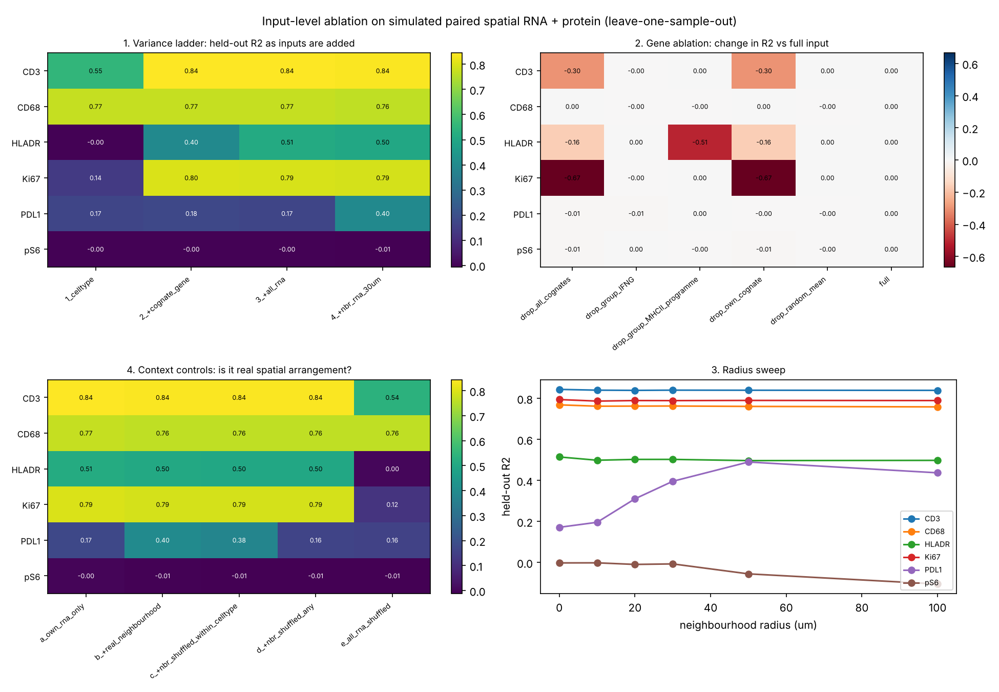
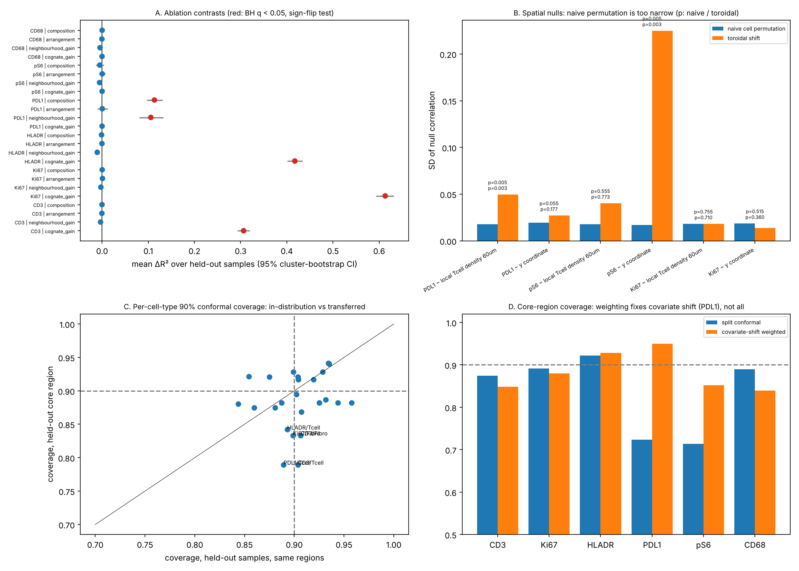

# 08 · Results

| Folder | What | Status |
|---|---|---|
| [`simulation/ablation/`](simulation/ablation/) | E1–E6, E8 on simulated paired data with known answers (`ablation_overview.png`, CSVs, console log) | ✔ |
| [`simulation/uq/`](simulation/uq/) | U1–U5: bootstrap CIs, sign-flip tests, conditional permutation importance, toroidal vs naive nulls, Mondrian and weighted conformal, shift decomposition (`uq_overview.png`) | ✔ |
| [`simulation/h1_ablation/`](simulation/h1_ablation/) | H1 ablations A1–A3: identity vs structure vs generic vs panel overlap, with positive controls | ✔ |
| `real/xenium_protein_rcc/` | first real-data information map | to do (Week 1) |

## Simulation: what the framework recovered

The simulated proteins each take their information from a planted source:

| Protein | Planted source | Recovered by | Key number (95% CI over 8 held-out samples) |
|---|---|---|---|
| CD3 | cognate gene | E1, E2 | cognate gain +0.31 R² (0.29–0.32) |
| Ki-67 | cognate gene | E1, E2, U2 | cognate gain +0.61 (0.59–0.63) |
| HLA-DR | MHC-II programme | E2, U2 | programme permutation importance 1.01 (0.98–1.04); dropping only the cognate costs 0.16 |
| PD-L1 | IFNG-expressing T cells within ~30 µm, tumour only | E1, E3, E4, U1 | neighbourhood gain +0.11 (0.08–0.13); composition +0.11 (0.10–0.13); arrangement ≈ 0 |
| pS6 | spatial gradient, no RNA | E1, E6, U3 | R² ≈ 0; residual Moran's I 0.84; toroidal p = 0.003 |
| CD68 | cell type | E1 | cell type alone R² 0.77 |

Transfer to the held-out tumour core (U4/U5): lineage markers keep 0.84–0.93 conformal coverage. PD-L1 drops to 0.72 and recovers to 0.95 under covariate-shift weighting (covariate shift; a region-specific model would do better). pS6 is unpredictable anywhere.

Pairing degradation (E8): cell-state proteins (Ki-67, HLA-DR) lose most of their RNA information within 20 µm of jitter; composition-driven PD-L1 survives same-type jitter up to 100 µm.

