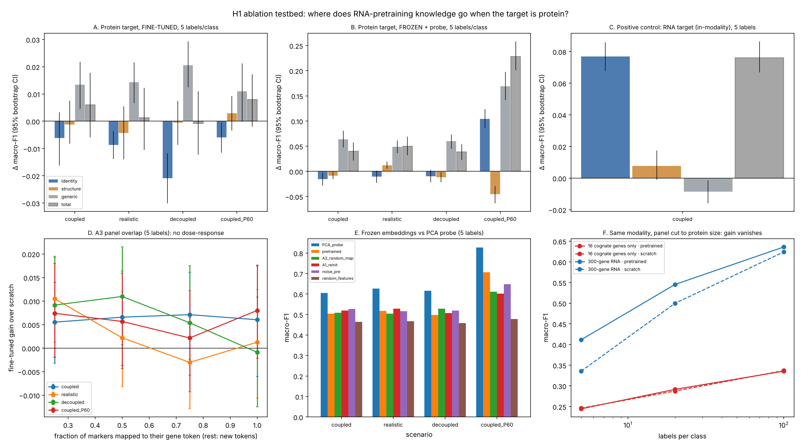

# H1 ablation testbed: results (simulation)

Code: [`../../../07_code/h1_transfer/ablation_identity_structure/`](../../../07_code/h1_transfer/ablation_identity_structure/) · Interpretation: [`../../../04_ideas/H1_transfer_learning/ablation_insights.md`](../../../04_ideas/H1_transfer_learning/ablation_insights.md)

## Key numbers (5 labels per class; Δ macro-F1, mean [95% bootstrap CI] over 15 seed × patient units)

| Setting | total gain | identity (pre − A1) | structure (A1 − noise) | generic (noise − scratch) | correct vs wrong map (pre − A2) |
|---|---|---|---|---|---|
| **RNA → RNA** (positive control) | **+0.076** [0.067, 0.086] | **+0.077** [0.068, 0.086] | +0.008 [−0.001, 0.017] | −0.009 [−0.016, −0.002] | **+0.107** [0.096, 0.119] |
| RNA → RNA, 16 cognate genes only | −0.002 [−0.008, 0.005] | – | – | – | – |
| RNA → protein, coupled (fine-tuned) | +0.006 [−0.006, 0.018] | −0.006 [−0.016, 0.003] | −0.001 | +0.013 [0.004, 0.022] | +0.010 [0.001, 0.020] |
| RNA → protein, realistic (fine-tuned) | +0.001 [−0.011, 0.012] | −0.009 [−0.014, −0.004] | −0.004 | +0.014 [0.007, 0.022] | −0.010 [−0.019, −0.002] |
| RNA → protein, decoupled (fine-tuned) | −0.001 [−0.012, 0.011] | **−0.021** [−0.030, −0.012] | −0.001 | +0.021 [0.012, 0.029] | **−0.017** [−0.026, −0.008] |
| RNA → protein, coupled, 60 markers (fine-tuned) | +0.008 [−0.002, 0.017] | −0.006 [−0.012, 0.000] | +0.003 | +0.011 [0.000, 0.021] | +0.005 |
| RNA → protein, coupled, 16 markers (**frozen**) | +0.040 vs random features | −0.015 | −0.009 | +0.064 | −0.005 |
| RNA → protein, coupled, 60 markers (**frozen**) | +0.228 vs random features | **+0.104** [0.086, 0.123] | −0.045 | +0.169 | **+0.095** [0.079, 0.111] |
| frozen pretrained − PCA probe (16 / 60 markers) | **−0.10 to −0.12** in every scenario | | | | |

- **A3 overlap** (fine-tuned, `A3_overlap.csv`): the gain over scratch stays between −0.003 and +0.011 whether 100%, 75%, 50% or 25% of markers use pretrained tokens. There is no dose-response.
- **More labels** (20, 100 per class, `decomposition.csv`): every gain shrinks toward 0. The in-modality identity gain goes +0.077 → +0.044 → +0.015.

## Files

| File | Contents |
|---|---|
| `raw_<scenario>.csv` | one row per mode × arm × labels × seed × held-out patient (macro-F1) |
| `decomposition.csv` | all contrasts, all label levels: mean, CI, sign-flip p, Holm-adjusted p |
| `A3_overlap.csv` | overlap curves |
| `mean_macro_f1.csv` | mean macro-F1 per arm |
| `h1_ablation_overview.png` | six-panel figure |
| `log_*.txt`, `analysis_console.txt` | run logs |

**Statistics note:** with 5 seeds, the exact sign-flip test cannot go below p = 0.0625 (two-sided), so all Holm-adjusted p-values are ≥ 0.31. Inference rests on the bootstrap CIs, and those are somewhat optimistic because the 15 units share 3 test patients.
