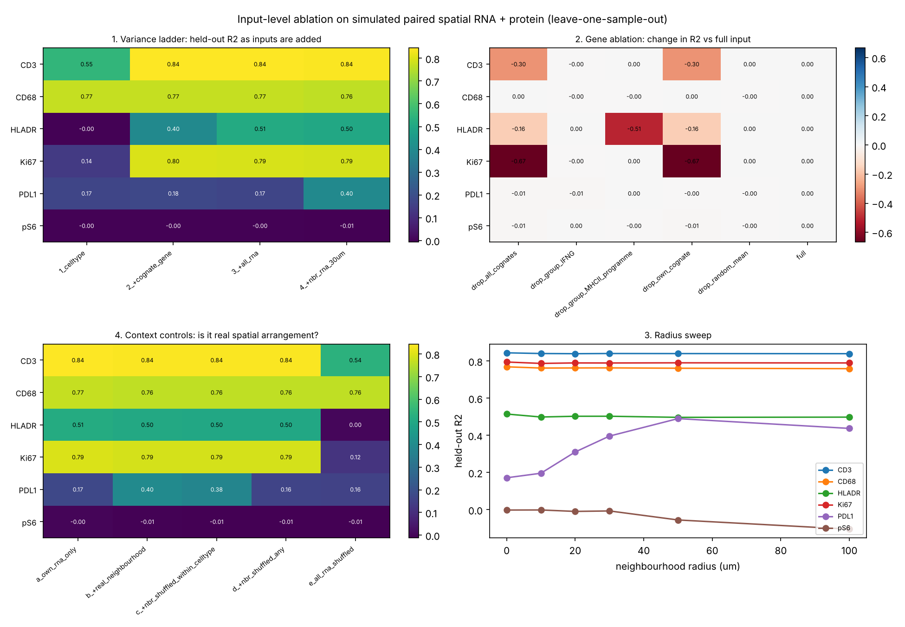

# Input-level ablation experiments: which RNA information is informative and transferable for protein?

Code: [`experiments/ablation/xmodal_ablation.py`](../experiments/ablation/xmodal_ablation.py) · simulation self-check: [`run_simulation_demo.py`](../experiments/ablation/run_simulation_demo.py)

## Principle

Keep **one fixed predictor** and change **only its inputs**. If accuracy drops when a piece of input is removed or scrambled, that piece carried information. Using a simple, fast model (ridge, one model per protein, with cell-type interactions) has three advantages: it runs every ablation in minutes, its gains cannot come from extra capacity, and its results become a baseline that H1/H2 foundation models and GNNs must beat. Every experiment is then repeated with the stronger model (H2's GNN, or frozen Nicheformer/Spatium embeddings) to check that the conclusions hold.

```
paired cells (same cell or same section)
  ├─ RNA  ──► [ablation: genes | radius | shuffles | regions] ──► features ──► fixed predictor ──► protein_j
  └─ protein ─────────────────────────────────────────────────────────────────────────────────► target
evaluation: leave-one-patient/slide-out (or spatial blocks); R², Pearson; per protein × cell type
```

## The six experiments

| # | Experiment | Manipulation (input level only) | Question answered | Read-out |
|---|---|---|---|---|
| E1 | **Variance ladder** | inputs added in order: cell type → + cognate gene → + all RNA (PCs) → + neighbourhood RNA | How much does each information source add? | ΔR² per step, per protein × cell type |
| E2 | **Gene ablation** | remove from *all* inputs: own cognate gene; all cognate genes; random gene sets of equal size; named programmes (MHC-II, IFN response, hypoxia, proliferation, ligand–receptor sets) | Is the information in the gene partner, in a programme, or spread everywhere? | ΔR² vs full; random sets are the null |
| E3 | **Radius sweep** | neighbourhood radius 0, 10, 20, 30, 50, 100 µm | At what spatial scale does neighbouring RNA inform protein? | R²(radius) curve; the peak marks the interaction range |
| E4 | **Context controls** | (a) own RNA only; (b) + real neighbourhood; (c) neighbours swapped for random cells **of the same type**; (d) neighbours swapped for any cell; (e) **all RNA shuffled across cells** | Is the gain about arrangement, composition, or nothing (leakage)? | b>c: cell *state* nearby matters; b≈c>d: only *composition* matters; e must collapse to the cell-type baseline |
| E5 | **Region hold-out** | train on all regions but one (core / margin / stroma, or annotated niches), test on the held-out one | Does the RNA→protein mapping transfer across tissue regions? | Pearson r on the held-out region (R² is misleading when the held-out variance is small) |
| E6 | **Residual map** | protein − RNA-predicted protein, then within-cell-type spatial autocorrelation (Moran's I with a within-type permutation null; full ctSVP methods in `ctsvp_baseline`) | What spatial protein biology does RNA *not* explain? | residual ctSVPs = candidate post-transcriptional / microenvironmental regulation |

Two further axes, run with the same code by changing the split:

| # | Experiment | Manipulation | Question |
|---|---|---|---|
| E7 | **Cross-dataset transfer** | fit on dataset A (e.g. Xenium Protein RCC), predict dataset B (DBiTplus lymph node, spatial-CITE-seq tonsil) on the shared gene × protein subset | Is the mapping platform- and tissue-general? |
| E8 | **Pairing degradation** (mirrors H2 arm H) | jitter RNA positions by 0/10/20/50/100 µm before building features, or replace same-cell RNA with adjacent-section neighbourhood RNA | How much registration error can the information survive? |

## How the ablations connect to H1 and H2

| This layer | H1 counterpart | H2 counterpart |
|---|---|---|
| E2 gene ablation (cognate vs random) | A1 re-initialise mapped token embeddings; A2 map markers to random gene tokens | arm I: drop protein markers (100/75/50/25%) |
| E4e RNA shuffled across cells | random-init control | arm G: teacher fed shuffled RNA |
| E8 pairing degradation | — | arm H: registration jitter |
| E5/E7 region and dataset hold-out | C1–C4 cross-modal transfer | stage 3: unpaired CODEX cohort |

**Prediction to pre-register:** H1/H2 gains should concentrate in the proteins and cell types where E1 shows high RNA-explainable variance *and* E5/E7 show that it holds on held-out regions and datasets. If a model gains on proteins the information map says RNA cannot explain, suspect leakage.

## Results on simulated data (self-check, `run_simulation_demo.py`)

Six simulated proteins each take their information from a known source (4 samples × 1,500 cells, 150 genes, leave-one-sample-out). The framework recovers each source:

| Protein | Planted source | What the ablations show |
|---|---|---|
| CD3, Ki67 | own cognate transcript | E1: cognate gene lifts R² 0.55→0.84 and 0.14→0.80. E2: dropping the cognate costs −0.30 / −0.67; random genes cost 0 |
| HLA-DR | MHC-II gene programme | E2: dropping the programme costs −0.51; dropping only the cognate costs −0.16 |
| PD-L1 | IFNG from T cells within ~30 µm (tumour cells only) | E1: neighbourhood adds +0.23. E3: R² rises from 0.17 (0 µm) to 0.49 (50 µm). E4: shuffling neighbours *within type* keeps the gain (0.38), shuffling across types removes it (0.16), so the signal is compositional |
| pS6 | spatial gradient, no RNA signal | nothing predicts it (R² ≈ 0); E6 residual Moran's I = 0.84 in tumour cells (p = 0.005) |
| CD68 | cell-type marker | cell type alone gives R² 0.77; no other input adds anything |

E4e (all RNA shuffled) collapses every protein to its cell-type baseline, as a negative control should. E5 shows PD-L1 transfers poorly to the T-cell-poor tumour core (r = 0.18 vs 0.71 at the margin), the kind of region dependence we expect in real data. One caveat the simulation exposes: dropping *IFNG* alone does not hurt PD-L1, because T-cell marker genes in the neighbourhood carry the same information. Gene-group ablations measure **unique** information, so redundant groups need joint ablation (or Shapley values over groups).



## Real-data plan

1. **Xenium Protein RCC / ccRCC** (377–477 genes + 27 proteins, same cell). Run E1–E6 per cell type. With a single slide, use spatial blocks or split the 465k cells into tiles.
2. **DBiTplus** (whole transcriptome + ~50-plex CODEX, same section, spot-level RNA) and **spatial-CITE-seq** (whole transcriptome + 273 ADTs, ~pixel level): E1–E4 at spot level, then E7 transfer from Xenium Protein on shared genes/proteins.
3. **SPATCH** (Xenium 5K / CosMx 6K + adjacent 16-marker CODEX): E8 with the measured registration error; this is the setting H2 stage 2 depends on.
4. Report a single **information-map figure**: proteins × {cell type, cognate, other genes, neighbourhood, residual-SV}, coloured by ΔR², with region/dataset transfer as a second panel.

## Practical notes

- Normalise RNA with log1p and per-sample scaling; protein with arcsinh (cofactor ≈ 5 for CODEX/IF, per-marker for Xenium protein) and per-sample z-score.
- Fit PCA/scalers on training folds only when the dataset is large enough for leakage to matter. The demo fits PCA on all cells, which is unsupervised and does not see protein.
- Report per cell type. A pooled R² is dominated by between-type differences, which is the same composition confounding the v1 ctSVP benchmark warned about.
- Use ≥3 random gene sets per ablation size, and report the mean and range.
