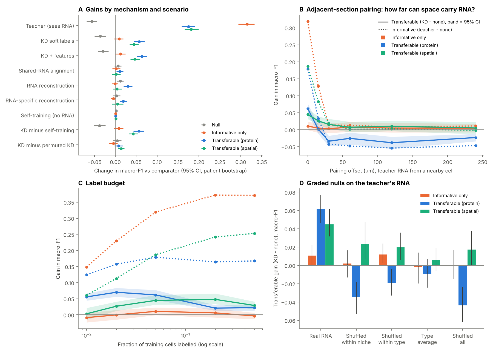

# Stage 2 simulation results

Simulation: 10 patients × 800 cells, 8 fine cell types (4 coarse × 2 subtypes), 150 genes, 20 markers, 5% of training cells labelled. Patient-level 5-fold CV, 3 seeds (main) or 2 seeds (ablations). Student = protein + neighbour-mean protein at 40 and 100 µm. All numbers are macro-F1 differences on held-out patients with 95% hierarchical-bootstrap CIs (patients, then seeds). Code: [`../../simulation/`](../../simulation/). Raw tables: `main_improvements.csv`, `ablation_deltas.csv`, `transfer_efficiency.csv`, `information_ceiling.csv`, `conformal*.csv`.

## 1. The designs separate informative from transferable

| Scenario (truth) | Δ_info = teacher − none | Δ_trans = KD − none | RNA-specific = KD − self-train | η = Δ_trans/Δ_info |
|---|---|---|---|---|
| null (RNA has no subtype signal) | **−0.056** [−0.069, −0.044] | **−0.036** [−0.050, −0.022] | −0.038 | undefined |
| informative only (subtype only in RNA) | **+0.315** [0.294, 0.333] | +0.009 [−0.003, 0.019] (equivalent to 0 within ±0.02) | +0.008 | 0.03 [−0.00, 0.05] |
| transferable via protein (weak protein signal) | **+0.175** [0.159, 0.190] | **+0.057** [0.044, 0.070] | **+0.057** | 0.33 [0.27, 0.38] |
| transferable via space (niche-linked subtype) | **+0.181** [0.166, 0.199] | **+0.044** [0.034, 0.055] | **+0.043** | 0.24 [0.20, 0.29] |

- **Informative ≠ transferable.** In the informative-only world RNA adds +0.32 when present, yet a protein-only student keeps ~3% of it, whatever mechanism is used. Distillation cannot create information that protein + space do not contain.
- **The transfer is from RNA, not from the unlabelled cells.** Self-training on the same unlabelled pool with a protein-only teacher gives +0.001 in every scenario. Label smoothing *hurts* (−0.02 to −0.035). Permuting the teacher's probabilities within its argmax costs only 0.005–0.013: most of the benefit is the teacher's **pseudo-labels on unlabelled cells**, and a little is dark knowledge.
- **A useless teacher hurts.** In the null world the RNA teacher is worse than the protein model (noisy extra inputs, few labels), and distilling from it costs −0.036. **Practical rule: distil only after Δ_info's CI is above 0.**
- Even at its best, the student keeps 24–36% of the informative gain (η). Information ceiling in NLL: the KD student closes 60–67% of the gap to the teacher, measured against the self-trained student so that pure calibration effects do not count.

## 2. Mechanisms

| Mechanism | protein route | spatial route | informative only | null |
|---|---|---|---|---|
| KD soft labels | +0.057 | +0.044 | +0.009 | −0.036 |
| KD + feature matching | **+0.064** | **+0.046** | +0.012 | −0.029 |
| RNA reconstruction (auxiliary) | +0.030 | +0.004 (n.s.) | −0.001 | +0.012 |
| RNA-specific reconstruction | +0.019 | +0.005 (n.s.) | −0.005 | +0.003 |
| Shared-RNA alignment (CCA stand-in for InfoNCE) | +0.010 | +0.002 (n.s.) | +0.002 | +0.006 |

Distillation (soft labels, optionally plus features) is the only mechanism that transfers through the **spatial** route. Auxiliary reconstruction helps only when protein itself carries the weak signal. The closed-form CCA alignment is weak here. That may be the stand-in, not contrastive learning as such, so InfoNCE is kept in the real pipeline. "RNA-specific" reconstruction is not a clean negative control: a *linear* residual still contains the weak protein-visible signal, so define "specific" non-linearly (or with cross-fitting) on real data.

**Uncertainty transfers even when accuracy does not.** At the same ≥ 90% coverage, KD shrinks 90% conformal prediction sets in every non-null world. In informative-only, sets shrink by −0.84 classes [−1.01, −0.69] vs none, and −0.82 vs self-training. The teacher teaches the student *which ambiguity is real* (the two subtypes of a coarse type), not which subtype it is. This is a third, reportable kind of transfer.

## 3. The input-level ladder locates the information (KD − none, Δ_trans)

| Manipulation of the teacher's RNA or of the student | protein route | spatial route | Reading |
|---|---|---|---|
| real RNA | +0.062 | +0.045 | |
| shuffled **within niche** | **−0.035** | **+0.023** | spatial-route information survives (it *is* niche information); cell-intrinsic does not |
| shuffled **within coarse type** | −0.019 | +0.020 | subtype read-out destroyed; the spatial world keeps the niche part |
| coarse-type average | −0.009 | +0.006 | |
| shuffled all | −0.044 | +0.017 (borderline) | |
| teacher sees **neighbourhood RNA only** | −0.034 | +0.015 | adjacent-section-style input transfers only niche-level information |
| **pairing jitter** 15 / 30 / 60 µm | +0.002 / −0.034 / −0.026 | +0.026 / +0.016 / +0.007 | cell-intrinsic transfer dies at ~1 cell diameter; niche transfer fades by ~60 µm |
| student **graph off** | +0.055 | **−0.022** | the spatial route needs the graph |
| student panel 10 / 5 markers | +0.063 / +0.066 | +0.069 / +0.070 | Δ_info grows as the panel shrinks; Δ_trans stays |
| labels 1% / 2% / 20% / 50% | +0.056 / +0.070 / +0.021 / +0.022 | +0.003 / +0.027 / +0.048 / +0.029 | protein route matters most with few labels; the spatial route needs a decent teacher first |

For real data: **adjacent sections (SPATCH) can at best deliver the niche-level part**, and only with a registration error well below ~30–60 µm. Same-cell data is needed to test cell-intrinsic transfer.

## 4. UQ notes

- Variance split: in most contrasts > 50% of the variance of the paired gain is residual (patient × seed interaction), patients 0–45%, seeds 0–20%. More patients help more than more seeds.
- TOST at ±0.02 can call a contrast both "non-zero" and "practically zero" (e.g. shared alignment +0.010 [0.002, 0.019]). Report both: small but real.
- With 10 patients the smallest two-sided sign-flip p is 0.002. With the 1–4 patients of P1/P2/P6/P9, report CIs as descriptive and use spatial blocks only as a secondary unit.

Limitations: numpy MLP, not a GNN (neighbour means stand in for message passing); one simulated label structure; CCA instead of InfoNCE. The real pipeline (`../../pipeline/`) has the GraphSAGE student, InfoNCE alignment and the same arms.
